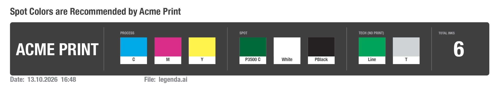
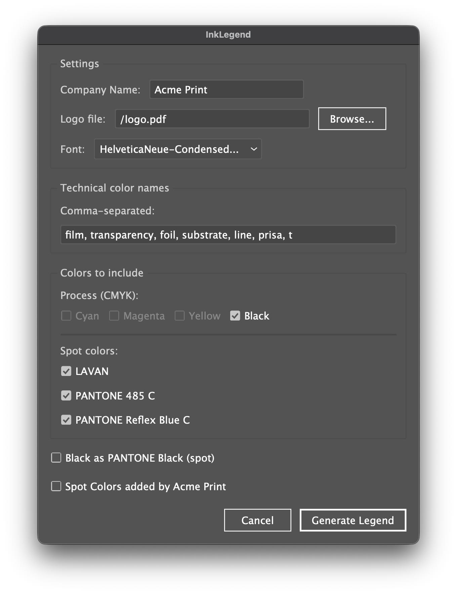

# InkLegend

**One click. One legend. Zero "wait, which inks are in this file?" messages.**

Every prepress operator knows the ritual: open the file, dig through swatches, squint at layers,
count the inks, type them into an email, miscount, repeat. InkLegend does the counting for you.

Run the script and a tidy dark strip appears on your artboard: one card per ink — process, spot and
technical — plus a big **TOTAL INKS** number. It's built from the colors that are *actually used* in the
document, not from the forgotten swatches that have been hanging around in the panel since the last
millennium.

It's a single `.jsx` file for Adobe Illustrator. No installer, no account, no subscription, no network
access. Free, MIT-licensed, and made to save a few minutes (and a few nerves) on every job.

## What you get

- **Only the inks that are really used.** An unused swatch doesn't make it into the legend.
- **Process / Spot / Tech sections.** CMYK channels, spot colors, and "technical" colors (film, foil,
  die lines and other things that never meet ink) are sorted for you. Technical colors are shown but
  not counted.
- **A total ink count** you can trust (process channels + spot colors).
- **Black as a PANTONE spot, in one click.** Many jobs print black as its own spot ink; tick the box
  and K moves to the SPOT section as `PBlack` — no dummy swatch to add and delete afterwards.
- **Your logo on the strip**, embedded in the file, so it looks the same on every colleague's computer.
- **Date and file name** under the strip.
- **Safe to re-run.** Edit the artwork, run it again: the old legend is replaced, not duplicated.

## Install

1. Download [`src/InkLegend.jsx`](src/InkLegend.jsx).
2. Pick one:
   - **Run it once, no install:** `File > Scripts > Other Script...` and choose `InkLegend.jsx`.
   - **Install it:** copy the file into Illustrator's Scripts folder and restart Illustrator. It will
     appear under `File > Scripts > InkLegend`.
     - Mac: `/Applications/Adobe Illustrator <version>/Presets.localized/<locale>/Scripts/`
     - Windows: `C:\Program Files\Adobe\Adobe Illustrator <version>\Presets\<locale>\Scripts\`
       (not tested by the author)
   - **One-click launch:** see below.

### One-click launch with JSX Launcher

If you run InkLegend all day, going through the menus gets old. [JSX Launcher](https://exchange.adobe.com/apps/cc/12096)
is a panel on Adobe Exchange that shows a button for every `.jsx` file in a folder you choose
(it opens from the Window menu, under Extensions). Drop `InkLegend.jsx` into that folder and it's one
click away.

It's a third-party tool, not part of this project, and an older one (version 0.1.6, 2019) — check that
it works with your version of Illustrator.

## Usage

1. Open a document in Illustrator and run the script.
2. In the dialog, review the detected colors, uncheck anything you don't want in the legend, set the
   font, and optionally pick a logo.
3. Click **Generate Legend**. A grouped object named `InkLegend` is placed in the top-right corner of
   the active artboard, 10 mm from the edges.
4. Changed the artwork? Run it again. The previous `InkLegend` group is removed and a fresh one is drawn.

## Settings

- **Company Name** — used in the optional notice above the strip: tick *Spot Colors added by …* and the
  legend says "Spot Colors are Recommended by …".
- **Logo file** — a logo (`.ai`, `.pdf`, `.eps`, `.png`, `.jpg`) shown at the left of the strip. Use
  **Browse...** to pick it. Leave it empty (or point it at a missing file) and a "LOGO" placeholder box is
  drawn instead. After the legend is generated the logo is **embedded** (not linked), so the document
  doesn't depend on the logo file being present on another computer. A vector logo stays vector.
- **Font** — any font installed in Illustrator, used for the whole legend.
- **Technical color names** — a comma-separated list of swatch names that should be treated as
  technical (non-printing) rather than as a real ink, e.g. `film, transparency, foil, substrate, t`.
  Entries of 1–2 characters must match the whole swatch name; longer ones match by prefix. In the swatch
  name, case, spaces, underscores and hyphens are ignored — so write the entry without them: `diecut`
  matches a swatch called `Die Cut`.
- **Black as PANTONE Black (spot)** — moves black (CMYK K, a gray fill, or a swatch named `Black`) from
  **PROCESS** to a `PBlack` card in **SPOT**, and counts it in **TOTAL INKS**. Nothing is added to the
  document's swatches. Greyed out when the file has no black.

Your choices are remembered between runs, per computer, in
`~/Library/Application Support/InkLegend/InkLegend_settings.json` (macOS) or
`%APPDATA%\InkLegend\InkLegend_settings.json` (Windows).

## How colors are detected

InkLegend reads fills, strokes and text colors of visible objects on every layer and sublayer of the
active document (including objects inside groups).

- **Process:** a CMYK channel is offered only if some object actually uses it; a gray fill counts as K.
  Swatches named `Cyan`, `Magenta`, `Yellow`, `Black` or `C=… M=… Y=… K=…` are treated as process too.
- **Spot:** every spot color used in the artwork (except `[Registration]`). Note that *global* process
  swatches are swatches too, so they are listed here as well.
- **Not detected:** colors that exist only inside gradients, patterns, symbols, meshes, or placed/raster
  images. If a color hides there, put a tiny vector rectangle filled with that swatch somewhere in the
  document and it will show up.
- **Names:** `PANTONE 485 C` is shortened to `P485 C` to keep the cards compact.

## Compatibility

Developed and tested on macOS with Adobe Illustrator 2026, on CMYK documents. It's plain ExtendScript with
no dependencies, so other recent versions and Windows *should* work, but that's untested — reports welcome.

## Feedback

Found a bug or have an idea? Open an issue. This is a spare-time project, so replies may take a while.
Pull requests are welcome; keep the code ES3-compatible (Illustrator's ExtendScript is old: no `let`,
`const`, arrow functions or `Array.map`).

## License

MIT — see [LICENSE](LICENSE). Provided as is, without warranty.

Adobe and Illustrator are trademarks of Adobe Inc.; PANTONE® is a trademark of Pantone LLC. This project is
not affiliated with or endorsed by either company.
